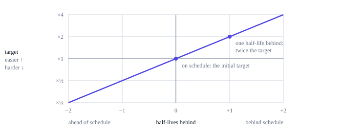

# Time and difficulty

Difficulty keeps blocks arriving near the target interval as hashpower comes and goes.
Ting sets every block's target from one fixed schedule that starts at genesis: the
further the chain falls behind the schedule, the easier mining gets, and the further
it runs ahead, the harder. It depends only on timestamps recorded in the chain, never
on a node's own clock. The exact rules are in
[section 9 of the protocol rules](../../../ting-protocol-rules.md#9-time-and-difficulty).

## Timestamps

A block's timestamp must be greater than the median of the timestamps of the blocks
before it: the previous eleven, or, while fewer than eleven blocks exist, all of them
plus the genesis timestamp. With an even number of samples, the upper of the two
middle values is used. One block may carry an earlier time than its parent, but the
median, and with it the earliest time the next block may carry, never moves
backwards.

That is the only consensus rule about time. A node should defer a header whose
timestamp is more than 7,200 seconds (two hours) ahead of its local clock, but that
is admission policy, not invalidity: the same block becomes acceptable once the clock
catches up. Difficulty and capacity calculations use only data in the branch.

Timestamps, like producer data, are context chosen by the miner. They are not
precise, they are not unpredictable randomness and they authenticate no external
identity; programs should not treat them as any of these.

## The retarget

Every block's target follows from one anchor, genesis, and one question: how far
is the chain ahead of or behind its schedule? The schedule says the parent of the
block at height *h* should have arrived `interval × (h − 1)` seconds after genesis.

```text
behind = (parent timestamp − genesis timestamp) − interval × (h − 1)
target = initial target × 2^(behind / half-life)
```

If the chain is one half-life behind schedule, the target doubles and mining gets
easier; one half-life ahead halves it. When blocks arrive exactly on time, the chain
keeps its distance from the schedule and the target stays where it is.



Suppose half the hashpower leaves a chain that is on schedule, with a 12-hour
half-life. Blocks start arriving about every two minutes, the chain falls behind
schedule and the target rises. The chain settles about 12 hours behind schedule,
where the target has doubled and the remaining miners again find a block about
every 60 seconds. If the hashpower comes back, blocks arrive early, the chain
catches up with its schedule and the target falls back.

There is no averaging window and no limit on how far one block can move the target.
Nothing makes mining easier just because a long time has passed since the last
block: being behind schedule is what matters, and a block that is early tightens
the target again.

The production genesis uses a 60-second interval and a 12-hour half-life, chosen by
simulating the loss and the arrival of hashpower
([production profile](genesis.md#production-profile)); the experimental
profile of development chains uses a two-day half-life.

## Exact arithmetic

Every node must compute the same target to the last bit, so the rule is written in
integer arithmetic rather than with real powers of two. The exponent is counted in
steps of 1/65536 of a half-life, a fixed cubic polynomial stands in for the
fractional power of two, every division rounds down, and the result is kept between
1 and the PoW limit. The first mined block, whose parent is genesis, gets the
initial target. A header's target must equal the result exactly: there is no
minimum-difficulty exception triggered by the clock or by a long gap between
blocks. The formula and every rounding step are in
[section 9.3](../../../ting-protocol-rules.md#93-exact-arithmetic).

## Where the rule comes from

This is the ASERT rule ("absolutely scheduled exponentially rising targets") that
Bitcoin Cash has used since November 2020 as `aserti3-2d`. It was chosen because a
window-based retarget oscillates on any chain that is not the biggest user of its
hash function: hashpower arrives when difficulty is low and leaves when it rises.
ASERT responds every block and cannot oscillate.

The polynomial and its fixed-point form are taken from the
[aserti3-2d specification](https://upgradespecs.bitcoincashnode.org/2020-11-15-asert/),
restated in the protocol rules with the genesis anchor; later changes to that
document do not change Ting. Ting's targets are not interchangeable with
aserti3-2d's, though. Ting rounds the exponent down where aserti3-2d truncates it
toward zero, so for a block ahead of schedule Ting's target can be one 1/65536 step,
about 0.001%, lower. And a Ting header carries its exact 256-bit target, where
aserti3-2d stores targets in the rounded compact `nBits` form.
