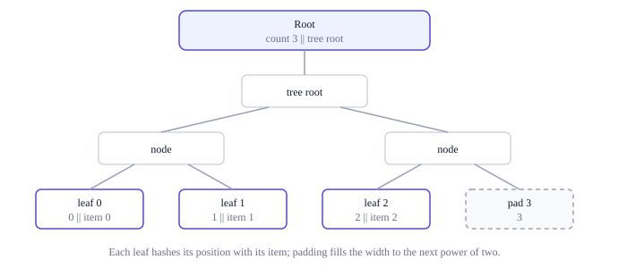

# Canonical bytes and hashing

Consensus hashes bytes, so every value Ting commits to needs exactly one byte
representation: a transaction that could be written two ways would have two
TransactionIds. Ting's encoding is therefore deliberately plain, and every hash
carries a tag that says what it is for. The exact rules are in
[section 2 of the protocol rules](../../../ting-protocol-rules.md#2-canonical-bytes-and-hashing).

## One encoding per value

- Integers have fixed widths and are little-endian. The one exception is the 256-bit
  mining target, which is big-endian.
- Hashes and identifiers are opaque 32-byte strings.
- Byte strings carry a four-byte length prefix.
- Fields appear in a fixed order. There are no optional fields, alternative forms
  or extensions.

A decoder rejects everything else, from unknown versions and kinds to trailing
bytes, instead of guessing what a sender meant. It checks every length against the
enclosing bytes and the active capacity before it allocates anything, so a hostile
peer cannot make a node reserve memory by sending a large length field.

Formulas are evaluated over exact integers: nothing wraps around, and nothing is
rounded unless the rule says so. A result that does not fit its field is invalid
([arithmetic](../../../ting-protocol-rules.md#23-arithmetic)).

## Types

Every layout in the wiki is built from these types, its fields encoded in the order
listed, back to back, with nothing between them.

| Type | Bytes | Encoding |
|---|---:|---|
| `u8`, `u16`, `u32`, `u64`, `u128` | 1, 2, 4, 8, 16 | Unsigned integer of exactly that width, little-endian |
| `u256be` | 32 | Unsigned integer, big-endian; used for mining targets |
| `bytes32` | 32 | Opaque string: a hash or an identifier |
| `Bytes` | 4 + length | A `u32` length, then exactly that many bytes |
| `ResourceVector` | 32 | Four `u64` values in the order C, S, D, G |
| `T[n]` | n × item | n items of type `T`; n is fixed by the layout or given by an earlier count field |

In formulas, `||` is concatenation, `u16(n)` is the integer `n` encoded as a `u16`
(likewise for the other widths), and `Bytes(x)` is `x` with its length prefix.

A `Bytes` item is at most `2^32 − 1` bytes long, and a list has fewer than `2^32`
entries: those are the widths of the length and count fields. A block is bounded by
its data capacity rather than by its encoding
([block capacity](../resources/capacity.md)).

## Domain-separated hashing

Every hash in the protocol is SHA-256 over a domain tag and the data:

```text
H(tag, x) = SHA256(ASCII("Ting/") || u16(len(tag)) || ASCII(tag) || x)
```

The tag names what is being hashed, because the same bytes can turn up in two
roles. A miner could make its producer data an exact copy of a block header; hashed
with the tag `producer` rather than `block`, those bytes give an unrelated hash, so a
producer hash can never pass for a BlockId. Likewise for every pair of tags: a value
hashed for one purpose can never be mistaken for one hashed for another.

The tag's length is part of the input, so the tag and the data split only one way:
the tag `ab` with the data `c` does not hash like the tag `a` with the data `bc`.
Inside the data, every field is either fixed-width or framed as `Bytes`, for the same
reason. Tags are literal, case-sensitive ASCII. SHA-256 is the standard hash
function, defined in full in
[section 29 of the protocol rules](../../../ting-protocol-rules.md#29-sha-256-definition),
so later revisions of the standard cannot change it.

The tags used by consensus:

| Tag | Hashes | Produces | Explained on |
|---|---|---|---|
| `chain` | The genesis configuration | ChainId | [Genesis](../consensus/genesis.md) |
| `genesis` | The ChainId | Identifier of the genesis anchor | [Genesis](../consensus/genesis.md) |
| `block` | The header | BlockId | [Proof of work](../consensus/proof-of-work.md) |
| `producer` | The producer data | The header's producer hash | [Blocks](blocks.md#the-header) |
| `transaction` | ChainId and the transaction | TransactionId | [Blocks](blocks.md#transactions) |
| `contract` | ChainId, TransactionId and ordinal | ContractId | [Records](records.md#identifiers) |
| `code` | A module's bytes | CodeHash | [Records](records.md#identifiers) |
| `state-key` | Namespace, ContractId and logical key | RecordKey | [Records](records.md#identifiers) |
| `state-leaf`, `state-node`, `state-empty` | Records and subtrees | State tree hashes | [State tree](state-tree.md#hashes) |
| `transactions-leaf`, `-pad`, `-node`, `-root` | A block's transactions | Transactions root | [Below](#ordered-commitments) |
| `receipts-leaf`, `-pad`, `-node`, `-root` | A block's receipts | Receipts root | [Below](#ordered-commitments) |

`H` is the protocol's own commitment function. It is not offered to programs as a
host function: a program that needs a hash computes it in its own code, as described
in [Cryptography lives in programs](../decisions/crypto-in-programs.md).

## Ordered commitments

A block commits to its transactions, and to its receipts, as ordered lists, so that a
32-byte root in the header pins down exactly which items the body holds and in what
order. Each item becomes a leaf that also hashes its position, so the same item at
another position has a different leaf. The leaves are padded to a power of two and
combined in pairs, level by level, and the final root also hashes the number of
items. Changing, moving, adding or removing an item changes the root.



A list of one item uses that item's leaf as its tree root, and an empty list still
has a root: the hash of the count 0.

A block uses this commitment twice, each time over the canonical encodings of the
items in body order: the transactions root with the tag `transactions`, and the
receipts root with the tag `receipts`. Leaves, padding, nodes and the root each
extend the tag with their own suffix, such as `transactions-leaf`, so a hash from one
level can never stand in for another. The exact construction is in
[section 2.5 of the protocol rules](../../../ting-protocol-rules.md#25-ordered-commitments).
