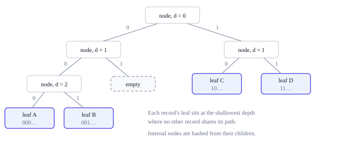

# The state tree

The state root in each header commits to every record in the state. Two nodes that
agree on it hold exactly the same records, and a client can check a single record
against it without downloading the rest. It is the root of a binary
**compact sparse Merkle tree** over the records' keys: the tree splits only as far as
it must to separate records, and a part of the tree that holds a single record is
just that record's leaf. The exact rules are in
[section 6 of the protocol rules](../../../ting-protocol-rules.md#6-the-state-tree).

## Shape

A record key's bits, most significant first, choose a path from the root: left for 0,
right for 1. Every subtree is one of three things:

- **empty**, when no record's key follows its path;
- **a leaf**, when exactly one record's key does;
- **a node**, when two or more do. Its two children split them by the next bit.

A record therefore sits at the shallowest depth where no other record shares its
path. Record keys are hashes, so that is about log₂ of the number of records deep:
17 levels for 100,000 records, 30 for a billion. Two keys that differ only in their
last bit put their leaves at depth 256, the deepest a tree can be.



In the diagram, the keys of A and B both begin with the bits 00, so the tree splits
on bits 0, 1 and 2 before they stand apart, and their leaves sit at depth 3. C and D
begin with 10 and 11 and part at bit 1. No key begins with 01, so that subtree is
empty.

A record's position depends only on its key and on which other keys exist, so the
root depends only on the set of records, never on the order in which they were
written.

## Hashes

Every part of the tree has a hash. A leaf hashes its record's key and value, a node
hashes its depth and its two children's hashes, and every empty subtree has the same
fixed hash, `EMPTY`. The hash at the top is the state root: an empty state has the
root `EMPTY`, and a state with one record has that record's leaf as its root. Leaves,
nodes and empty subtrees each hash with their own
[tag](encoding.md#domain-separated-hashing), so a leaf can never pass for a node.

These hashes are derived from the records. They are not records themselves and are
not part of the state map. The exact definition is in
[section 6.2 of the protocol rules](../../../ting-protocol-rules.md#62-hashes).

## Changing a record

Only one path changes when a record does:

- **Writing an existing record** replaces its leaf.
- **Creating a record** takes the empty subtree where its path ends. If its path
  instead ends at another record's leaf, both move down to the first bit where their
  keys differ, and nodes fill the levels between, each with one empty side.
- **Deleting a record** empties its place. If its parent's other child is then a
  single leaf, that record moves up, and keeps moving up for as long as it is alone.

Then the nodes on the path are hashed again up to the root: about log₂ of the
number of records of them, and never more than 256.

## Why this shape

- **Bounded work per record.** A change touches one path, of at most 256 nodes and
  usually far fewer. Keys are hashes, so making two keys share their first `b` bits
  takes about 2^b attempts: a deep path is expensive to build and still bounded. A
  record operation is one random access and one path, which is exactly what the
  state-access counter counts. Hashing the value itself into its leaf is byte work,
  charged as compute when the record is written.
- **Incremental updates.** Changing one record recomputes one path, not the whole state.
- **Short proofs.** A proof carries one hash per level of the record's path.
- **Freedom underneath.** How a node stores the tree, whether it caches, batches
  writes or uses another database, is its own business, as long as the root comes
  out the same. None of it is consensus-visible: a cache miss or a physical disk read
  never costs any resource. See [what each counter measures](../resources/counters.md).

## Proofs

A proof lets a client check one record against a state root it trusts, without
trusting the node that served it. The protocol rules define the tree's hashes but
not a proof format; the format below is the reference node's.

A proof that a record is present gives its value and the hashes of the other child at
each level of its path, from its leaf up to the root. The verifier hashes the leaf,
combines it with each of those hashes in the order the key's bits say, and compares
the result with the state root.

A proof that a record is absent ends the key's path at an empty subtree, or at the
leaf of a different record whose key shares that path. That record comes with its
key and value, and the verifier hashes its leaf from them: a leaf hash alone could be
any leaf, the absent record's own included, so it would prove nothing about which key
the path leads to.

### Asking for a proof

The reference node's storage reads return proofs when asked: with `proof=true` on
`GET /v1/contracts/{id}/storage/{key}`, or `"proof": true` in a `POST /v1/storage`
batch ([the REST API](../start/explore.md#the-rest-api)). Each record in the answer
comes with its value as `value_hex`, `null` when absent, and a `proof`:

| Field | Content |
|---|---|
| `record_key` | The record's key, which the verifier computes for itself from the contract and the storage key |
| `end` | Where the key's path ends: `present`, the record's own leaf; `empty`, an empty subtree; `other`, another record's leaf |
| `other_key` | For `other`: that record's key |
| `siblings` | The other child's hash at each level of the path, from its end up to the root |

The answer as a whole gives the `state_root` and the canonical `tip` it was read at,
and `others`: the value of each record a proof ends at, as hex under that record's
key. Many proofs of one answer can end at the same record (a program's code, for
example), so each value is listed once. A proof whose `other_key` has no entry there
does not check.

### Checking a proof

The verifier needs these [domain-separated hashes](encoding.md#domain-separated-hashing).
A storage record's key uses namespace 2 ([namespaces](records.md#namespaces)):

```text
record_key     = H("state-key",   u8(2) || contract || key)
leaf(k, v)     = H("state-leaf",  k || Bytes(v))
node(d, l, r)  = H("state-node",  u16(d) || l || r)
EMPTY          = H("state-empty", "")
```

A key's bits are counted from the most significant bit of its first byte, which is
bit 0. With `n` siblings, at most 256, the path ends at depth `n`. The verifier:

1. Computes `record_key` itself.
2. Starts with `h`, the hash where the path ends:
   - for `present`, `leaf(record_key, value)`, where the answer's value must not be
     `null`;
   - for `empty`, `EMPTY`, where the answer's value must be `null`;
   - for `other`, `leaf(other_key, others[other_key])`, after checking that
     `other_key` differs from `record_key` and shares its first `n` bits; the
     answer's value must be `null`.
3. For `d` from `n − 1` down to 0, takes the next sibling `s` and replaces `h` with
   `node(d, h, s)` when bit `d` of `record_key` is 0, or `node(d, s, h)` when it
   is 1.
4. Compares the final `h` with the state root.

A proof checks only against a root the client trusts: one in a header it has
checked, on the chain with the most work.
