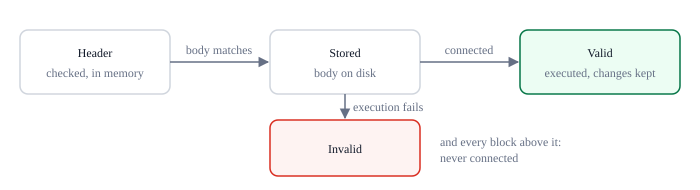
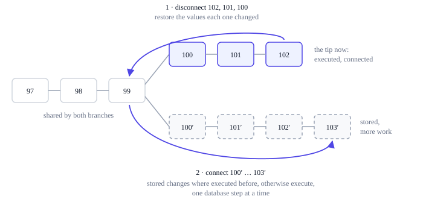

# Storage and recovery

How a node stores the chain is its own business. The physical layout does not change
any protocol hash or charge. This page describes the reference node's choices.

## Two stores

- **Block files.** Canonical block bytes live in checksummed, append-only segment files
  under `blocks/`, each up to 128 MiB, or holding one larger block alone.
- **The state database.** An embedded redb database, `chain.redb`, stores where each
  block is, compact block metadata, the current records, the state-tree nodes,
  per-block changes and transaction indexes.

The whole state does not need to fit in memory. During execution, the VM works on a
small overlay containing only the records it touches, with a journal for nested calls.

## Block files

Segment files are named `blocks/00000000.dat`, `blocks/00000001.dat` and so on. Each
starts with a 40-byte header, the 8 bytes `TINGBLK\0` followed by the 32-byte
ChainId, and then holds one frame per block:

```text
u64 little-endian length ‖ canonical block bytes ‖ H("node-block", block bytes)
```

`H` is the protocol's [domain-separated hash](/wiki/data/encoding). The block in a
frame is at least 302 bytes, the size of an empty block with no producer data, and a
frame never spans two files: a new file begins when the next frame would not fit in
128 MiB. A frame larger than that begins a file of its own and is the only frame in
it, so no block is too large to store. A block's location in the database is a `u32`
file number, a `u64` byte offset and a `u64` block length, and the database's file
cursor marks the end of the last indexed frame.

## The database

`chain.redb` uses a bounded page cache, 256 MiB unless `"db_cache_mib"` in
`config.json` says otherwise; a larger cache keeps more of the state tree in memory
on a node with memory to spare. Its tables hold:

| Table | Content |
|---|---|
| `metadata` | The storage format version, the ChainId, the canonical tip, the state root, the record count, the file cursor, the height up to which undo data is pruned, and the settled height ([the block index](#the-block-index)) |
| `block_locations` | Where each stored block's frame is |
| `headers` | Every stored block's header, its status (stored, valid, or failed) and its accumulated work |
| `operator_marks` | The blocks the operator marked invalid ([overriding validity](#overriding-validity)) |
| `block_limits` | The active limits of each settled block ([the block index](#the-block-index)) |
| `side_blocks` | Every stored block off the canonical chain, with its height |
| `canonical` | Block id by canonical height |
| `records` | The current logical state records |
| `record_lengths` | Each current record's value length, so that a length query or an overwrite never reads the value |
| `merkle_nodes` | The state tree: each node's hash, and each leaf's record key and hash, by position |
| `block_changes` | Each block's undo data: the previous value of every record it changed |
| `block_redo`, `redo_blocks` | The resulting values of the records a disconnected block changed, and which blocks have them, by height |
| `value_parts` | The parts of values larger than 1 MiB in `records`, `block_changes` and `block_redo` |
| `transaction_occurrences` | Every transaction occurrence, by transaction id, height, block id and position |

Hashes, record values and encodings keep their protocol meaning. An empty value is a
present record, and absence is encoded separately. A value of up to 1 MiB is kept in
its row; a larger one is split into parts of 1 MiB in `value_parts`, by its table, its
row's key and the part's number, and its row holds only its length. No database value
therefore nears redb's limit of 3 GiB, and the node stores a record of any size the
protocol allows.

The tree is stored as it is defined: one entry for each node and one for each leaf,
at the position where it sits, so about two entries per record. A leaf's entry holds
its record key and leaf hash, so that moving a record up or down the tree never
reads or hashes its value.

## Execution against the database

The VM reads either an immutable database view or the view of a private write
transaction, through a storage abstraction. Its in-memory overlay and nested-call
journal hold only the records and Merkle paths it touches. Values are shared between
the overlay and the journal rather than copied, and a length query or an overwrite
reads only the record's length.

Validated programs stay decoded in memory across blocks, keyed by CodeHash, in a cache
bounded by 256 MiB of decoded programs, counted by the memory each takes decoded,
which is many times its code; the program used least recently leaves first. A program
that is not cached is read and decoded again when it is called.

A database failure is a node failure. It never turns into a missing record that
consensus would accept, nor into a transaction trap with an accepted receipt. No
physical I/O, cache miss, reversed change or database operation changes C, S, D or G.

## Per-block changes

For every block it executes, the node keeps the block's **undo data**: the previous
value of each record the block changed, once per key, including the manifests and
code records the runtime manages. Changes that a call later reverted, and records
that ended where they started, are left out. Undoing a block applies its undo data,
and the root it reaches must be its parent's.

When it disconnects a block, the node first keeps the block's **redo data**, the
values that block left, which it reads from the state before undoing it. Connecting
that block again applies them without executing it; a block without redo data is
executed again, which gives the same result.

Undo data is the largest thing a node keeps, and nothing in the protocol bounds it:
an overwrite of a large record pays no growth, so one block can replace about 10 MB
of values. A node therefore keeps it for a window, by default the last 43,200
canonical blocks, 30 days, and the redo data of disconnected blocks as long
([deep reorganizations](#deep-reorganizations)). `"undo_window"` in `config.json`
sets the window in blocks; `0` keeps everything.

## What a node holds of a block



- **Header.** Checked and in the header tree, in memory only
  ([headers first](/wiki/node/sync#headers-first)).
- **Stored.** The body is in a block file and matches its header, but has not been
  executed. Its location, header and work are in the database.
- **Valid.** Executed on its branch, with its record changes kept. Only valid blocks
  are ever connected.
- **Invalid.** Its execution failed, or the operator marked it invalid, or it sits
  above such a block. It is never connected, and neither is anything built on it. A
  failed block's status is stored, and so is the operator's mark; what sits above
  follows from them, so a restart tries none of it again.

## The block index

The node keeps an index of the blocks it knows: for each, its header, its
accumulated work, the limits it runs under and what the node holds of it. Choosing,
downloading and connecting the best branch work from it. The index holds in memory
the most recent canonical blocks, every side branch, and the headers whose blocks are
not stored yet. Canonical blocks further down are **settled**: the index reads them
from the database when it needs them, their header and work from `headers` and
their limits from `block_limits`. Its memory therefore does not grow with the length
of the chain.

The index holds at least the last three voting epochs of canonical blocks, whose
votes a header check counts, and eleven more, or the undo window if that is longer:
60,491 blocks on the production network, about 42 days. Below that, blocks settle 64
at a time once the tip has moved on, in one database transaction that records their
limits and the new settled height. Only an executed, valid canonical block that the
operator has not marked, and that the best header's branch also holds, settles.

Settled blocks are canonical by definition, so before anything at or below the
settled height changes, the node holds the blocks above the new height in memory
again, writing the lower height first: before it follows a branch that forks there,
before the best header's branch forks there, and before the operator marks or
reconsiders a block there. A reorganization of any depth therefore still works as
above, with a moment's reading from the database first.

A side branch whose blocks all lie at or below the settled height, some 42 days or
more behind the tip on the production network, is forgotten as blocks settle and when
the node opens: it leaves the index, and what is stored of its blocks leaves the
database, their location and header, the occurrences of their transactions and any
undo and redo data. Their frames stay in the block files, unreferenced, as the files
are only ever appended to. Should such a branch ever be extended past the tip, it is
fetched again like any other branch. The node's status shows
`settled_height`, the height at or below which canonical blocks are settled, and
`held_headers`, the index entries in memory.

## Connecting the best branch

Of the branches whose blocks are all stored and none invalid, the node connects the
heaviest that either grows its tip with more work or exceeds the tip's work by the
[fork-choice margin](/wiki/consensus/proof-of-work). Most of the time that branch is
the tip plus one new block, and connecting it executes that block; a heavier side
branch that does not clear the margin never holds the tip back from growing. When it
is another branch, the node moves to it:



1. **Disconnect** the connected blocks back to the last block both branches share,
   newest first, each by its undo data, keeping its redo data.
2. **Connect** the other branch's blocks, oldest first: a block with redo data, from
   an earlier visit to this branch, by applying it; any other by executing it against
   the state its parent left, checking every commitment, and keeping its undo data.

Every state root reached is checked against its header. The move goes in steps, each
one database transaction: disconnecting up to 64 blocks, connecting up to 64
already-executed blocks, or executing one block. A reorganization of any depth
therefore never holds more than one step's changes in memory, and the node answers
requests between steps. Between two steps the tip may briefly have less work than
before; the next step continues toward the heavier branch. Until the move ends, every
choice is measured against the tip it began from, not the one it has reached.

A block whose execution fails is marked invalid, with every block above it, and the
node then connects the heaviest branch that is left by the same rule, which is the
one it came from unless another clears the margin against it: that branch's blocks
have their redo data, so going back is cheap. A branch
that cannot be connected for another reason, such as damaged undo data, leaves the
node on its tip with a message on standard error, at startup too.

Each reorganization, once the tip has settled, is reported on standard error with
the number of blocks replaced and the height above which they were, and the last one
appears in the node's status as `reorganization`: `replaced`, `fork_height`, `height`,
`tip`, `time` and `deep`. One that replaces six blocks or more is a deep one, logged as
a warning: it is valid, since reorganizations have no depth limit, but it means a
network split healing, a miner with most of the work, or a fault, and a service that
waits for confirmations may want to look.

## Deep reorganizations

A branch that forks below the window needs undo data the node no longer has. The
node then stays on its tip and, in the background, replays its canonical blocks
from genesis into a temporary database next to its own, from block files alone,
checking every state root on the way. It keeps the undo data of each block between
the fork and the window as the replay passes it, copies it into its database a step
at a time, and carries out the reorganization as any other. There is no depth limit:
the deeper the fork, the longer the replay, never a refusal. A restart during the
replay starts it again.

The temporary database holds a second copy of the state until the replay ends, so a
node must have room for it. An archive node, `"undo_window": 0`, never needs a
replay. The node's status shows `undo_pruned`, the height up to which canonical
blocks have no undo data, and `replaying` while a replay runs.

## Warnings

The node's status lists `warnings` that need its operator. There is one: a branch
that failed validation here carries more than six blocks of work more than the tip.
The work counted is that of checked headers, so it cannot be claimed without being
done. Either the branch is invalid and most of the work goes to it, or this node
follows other rules than much of the network, as after a fault in it or in an
update. The warning is also logged once, and goes away when the tip comes within six
blocks of the branch's work.

## Overriding validity

An operator can override what the node accepts, for the rare case of a fault in the
node itself, through the [control channel](/wiki/node/security#the-control-channel):

- **`ting invalidate BLOCK`** marks a block invalid, by id or by the height of a
  connected block. The node disconnects it and every block above it if they are
  connected, then connects the best branch that is left, and never connects the marked
  block or anything above it. A block not seen yet can be marked too: it is refused
  when it comes. The mark is kept across restarts. Peers that send a marked block, or
  one above it, are answered with `block marked invalid by this node's operator`: a
  refusal of this node's own, held against no peer.
- **`ting reconsider BLOCK`** clears the invalid status of the block, of every block
  above it and of every block below it, whether the operator marked them or their
  execution failed, and connects the best branch again. A block executed before keeps
  its record changes, so a reconsidered branch is reconnected without executing it
  again; a failed block is executed again, and if it fails again, it is invalid again.

So a node that accepted a block it should not have can be moved off it at once,
without waiting for a fixed release; and one that refused a valid block, as before a
fix, can take it again without being synchronized from scratch. The genesis block
cannot be marked. A change that moves the tip far may take longer than the CLI waits
for an answer; the node carries on regardless, and `ting status` shows where it is.

Merkle paths are recomputed with the exact rules of the
[state tree](/wiki/data/state-tree). Reorganizations have no depth limit.

Readers see the old committed view until the new transaction commits, never a mix:
REST's reader threads read beside the chain thread this way. A block executes
against the last commit, which its own step has not yet changed, through a read view
whose tables open once; its changes are then written in the step's transaction. No
write by a program commits on its own: its effects reach the database only through
the block's transaction.

A block's frame is always forced to disk before its commit, but the commit itself is
forced to disk only for the first block after the node opens, for the first block in
each new segment file, and otherwise at least every five minutes; redb's quick repair
is enabled. Commits that store no block, those of a reorganization or of the operator,
follow the same five minutes, the first after opening forced, and the moves the node
makes as it opens are forced before it serves anyone; commits left unforced are
forced once five minutes have passed, whether or not a block arrives. Forcing every commit would be most of the time a block of state writes
takes. After a crash, the database holds the last forced commit, and every frame
written since lies in that commit's segment or the next one, where recovery finds
and replays them. A clean shutdown forces everything. If a commit fails, the chain
worker stops: the node is reopened and recovers, instead of guessing which commit
reached stable storage. A failed import that leaves an unindexed frame at the end of
the block files also stops the node until it is restarted.

## Restarts

On restart the node opens its stored validated state and loads the metadata of the
blocks its index holds in memory: the canonical blocks above the settled height, and
the side blocks `side_blocks` lists. It reads no settled block, no historical block
body and no transaction, so a restart takes as long however long the chain. A
database from before `side_blocks` fills it once, from every stored header. Before it serves
anything it checks that:

- every header it loads hashes to its block id, carries this ChainId and has a block
  location;
- the stored tip matches the canonical mapping, which has no gaps, and every
  canonical block it holds has the parent and height that follow from the one
  before, the first from the highest settled block;
- every block it loads has the height, proof of work and accumulated work that
  follow from its parent, and every canonical block is valid;
- the stored record count equals the number of records and of record lengths, and the
  state root matches both the tip's header and the persisted root node.

A stored block whose parent was only a header when the node stopped, as blocks
arrive out of order, waits outside the index until that header comes again, and is
then indexed with it.

Frames appended after the file cursor, left by a crash before their commits reached
the disk, are stored again in the order they were written, without appending another
copy. One whose parent comes in a later frame, as blocks arrive out of order, is
tried again once the others are in, for as long as that stores more; one still left
over, such as one whose parent was only a header, is passed over, and its block is
fetched again. Nothing refers to a frame after the cursor, so a damaged one,
incomplete, zero-filled as a power loss may leave it, or with a wrong checksum, is
truncated with everything after it in its file, and its block is fetched again. Then
the operator's marks are applied, and the node connects the heaviest stored branch,
as above: after a crash in the middle of a reorganization, it simply carries on.
Last, what lies below the held heights settles: all of it at the first start of a
node whose index held every block.
Indexed frames are checksum-verified when they are read, rather than scanned at every
restart; a stored block whose frame no longer reads back is forgotten, its header
kept, and fetched again. The database's own checksums are responsible for physical
integrity.

A database or block file made for a different storage format or a different genesis
is rejected, never reset.

## Reading history

Block bodies are read from disk on demand. Transaction lookups use the occurrence
index and keep only occurrences on the canonical chain, so a transaction id that
appears in several blocks lists every occurrence, page by page.

The mempool is not stored; deferred transactions are, in `deferred.json`, as described
in [Mining and voting](/wiki/node/mining#deferred-transactions). A `deferred.json`
that does not parse is moved to `deferred.json.corrupt`, with a message on standard
error, and the node starts with an empty set.

## Pruning and retention

The reference node keeps the body and header of every canonical block, and the undo
data of the last 30 days ([per-block changes](#per-block-changes)); side branches
long behind the tip are forgotten ([the block index](#the-block-index)). There are no
snapshots and no other historical state pruning. A node may prune old local data without redefining historical validity,
provided it keeps, or can obtain, the state and data needed for the validation it
performs. Live-state growth and historical retention are separate questions. There is
no state rent or expiry, so the growth capacity miners vote is the only bound on how
much state the network commits to keeping.
