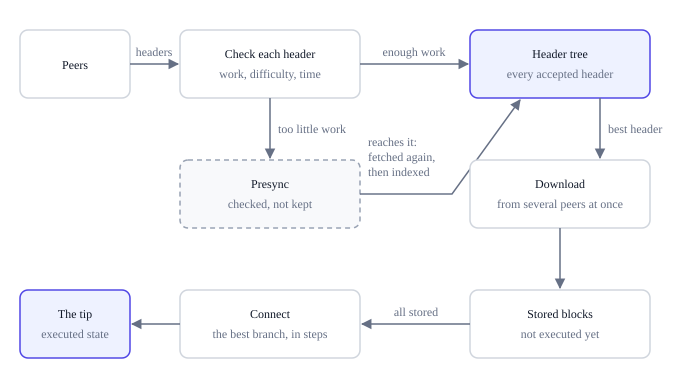
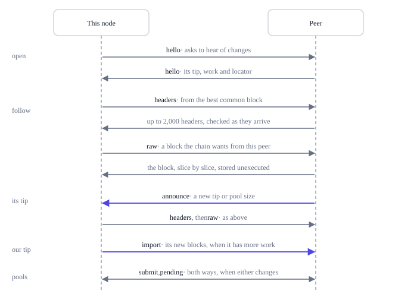

# Peers and synchronization

The reference node synchronizes with the peers it finds through the network's seed
nodes, those named in its configuration, and those it learns of from both. It
follows the branch with the most work, at any depth: there is no point beyond which
it stops reorganizing, so a network that split heals by itself once its parts
reconnect.

In outline:

- The node keeps one connection open to each of its peers, and a new tip travels
  over it in both directions ([connections](#connections)).
- It learns of blocks from their headers, checks each header as it arrives, and
  fetches bodies only along the branch of the best header
  ([headers first](#headers-first), [blocks](#blocks)).
- It stores a body once it matches its header, and executes it only when its branch
  is connected ([storage](storage.md#connecting-the-best-branch)).
- Over the same connections it pushes its own new blocks, exchanges pending and
  deferred transactions and, with discovery on, peer addresses
  ([finding more peers](#finding-more-peers)).
- A peer that sends data breaking the rules is disconnected and, unless it is a
  configured peer or on the same machine, banned for a day
  ([invalid data](#invalid-data)).

The transport is a small binary protocol over TCP: blocks, headers and transactions
travel in their consensus encodings, framed with the few fields each message needs.
It is separate from the consensus rules and can be replaced without affecting them.
[Peer protocol](../reference/peer-protocol.md) specifies it, for implementations
that talk to reference nodes.

## Connections

A node keeps one connection open to each of its peers: every configured peer, and
the discovered peers it currently keeps (see [Finding more peers](#finding-more-peers)).
It skips its own peer address. Over each connection the peer tells the node when its
tip changes, and the node follows:

1. **Hello.** The node sends `hello` with its protocol version, its software, its
   features, its ChainId, its nonce, the `announce` flag and, with discovery on, its
   listening port. The peer answers with its state, which carries its own version,
   ChainId, nonce and tip. A version below 1 or another
   ChainId ends the connection ([versions](../reference/peer-protocol.md#versions)).
2. **Rounds.** The node then works in rounds, each doing what is due, in this order:
   - **Headers**, at the first round, when the peer announces a new tip, and at every
     keepalive: the node sends its locator with `headers`, and keeps asking from the
     last header received while full pages of 2,000 come back, up to eight pages a
     round. Each header is checked as it arrives and indexed, or checked without
     being kept ([headers first](#headers-first)).
   - **Blocks**: it asks the chain which blocks to fetch from this peer, up to 64 at
     a time along the best header's branch, fetches each with `raw`, slice by slice,
     and stores it ([blocks](#blocks)). A peer that does not have one is passed over
     until it announces a new tip, and the others are asked.
   - **Push**, when this node's tip has changed and has more work than the peer's:
     the node asks the peer for its `state` and finds their best common block from
     the peer's locator, with the last block the peer took from this connection's
     pushes put first. It sends up to 32 blocks after that common block, in order,
     with `import`: a block that fits one 1 MiB slice whole, a larger one
     [slice by slice](#blocks). The last block taken matters past a deep fork, where
     a locator thinned out by its doubling gaps may name no shared block but
     genesis.
   - **Pending and deferred transactions**, when either pool has changed and at
     every keepalive: for each, it asks the peer for its `inventory`, the ids it
     holds, page by page until it has as many as its own set can hold, and
     compares it with its own. It submits to the peer the transactions the peer
     lacks, deferred ones with their `not_before` times, up to the last id it
     read: past it, it cannot tell what the peer holds. It fetches the ones it
     lacks itself by id, 32 at a time, and submits them locally as relayed by that
     peer. Each transaction travels once a connection each way, whether or not it
     was taken: two pools that stay apart, as full ones do, cost nothing more until
     they change. One refused for want of room is tried again once this node's
     tip has moved, since a block makes room, at most the next block's data
     capacity of them each way at each tip: no more than a block can have freed.
     A transaction larger than one 1 MiB slice travels in slices both ways
     ([transactions in slices](#transactions-in-slices)).
   - **Addresses**, with discovery on: it asks for `addresses` and adds what it
     receives to its address book, every ten seconds while it has fewer peers than it
     wants, otherwise every ten minutes.
3. **Waiting.** Between rounds the connection waits for a change: at this node a new
   tip, pool or stored block; at the peer an announcement. After 30 seconds without
   one (ten while the node looks for more peers), the keepalive runs a round anyway,
   so the connection stays open and nothing is missed. A round that left header pages
   or blocks to push is followed by the next at once; rounds start at least 0.1
   seconds apart.

Deferred transactions travel only to peers that keep a deferred set, because a peer
without one would pool them at once. For the same reason, pooled transactions that
are still in the deferred set are left out of the pending exchange.

**Announcements.** A peer that asks for them in its `hello` is told, between answers,
whenever the answering node's tip or pool sizes change, at most once per 0.2 seconds:
its tip, height and accumulated work, and the sizes of its pool and deferred set.

So over one connection a new tip travels both ways at once: the answering node
announces its own, and the connecting node pushes its own. Configuring one side is
enough. A node that cannot be reached from outside, behind a NAT without a forwarded
port, takes part fully this way: it connects out, hears its peers' tips over its own
connections, and pushes its blocks over them. Its announced listening address is
never confirmed by a connection, so it is never shared ([finding more
peers](#finding-more-peers)).

**Failures.** A connection whose request fails, or gets no reply within 30 seconds,
ends. The blocks it was asked for go back to the other connections, and `ting peers`
shows each peer's last success, or its last attempt and error. A configured peer is
connected again a minute after the failed attempt; a discovered one waits a minute,
doubling with each further failure up to an hour, and is replaced meanwhile.

**Refusals.** A refusal that is one node's policy is not a failure, and the
connection stays open past it:

- A block on a branch more than a day's work behind the tip, whose header the node
  has not indexed, is answered with `branch too far behind the tip` and neither
  stored nor executed ([headers first](#headers-first)). The pushing node stops
  pushing.
- A block whose timestamp is more than 7,200 seconds ahead of the receiving node's
  clock is answered with `timestamp ahead of the clock` and not stored, as
  [Time and difficulty](../consensus/difficulty.md#timestamps) asks. The pushing
  node stops pushing, since the block's descendants would wait too; a node checks its
  own clock the same way before it takes a header. The block is offered again later
  and accepted once the clock has caught up.
- A block the operator marked invalid, or one above it, is answered with
  `block marked invalid by this node's operator`, and its header the same way
  ([overriding validity](storage.md#overriding-validity)). It is not stored,
  and held against no peer.
- A transaction either side does not take, such as one refused with
  `mempool is full`, is skipped and the exchange continues with the next one. A
  transaction relayed by a peer that a recent block included is refused with
  `transaction already included` ([the mempool](mining.md#the-mempool)), so
  a transaction just mined does not travel back into the pools: for a day if it
  succeeded, for ten blocks if it failed.

## Headers first

A node learns of blocks from their headers, which are small and cheap to check, and
fetches bodies only for the chain they show to be the heaviest, as Bitcoin does. A
peer's claimed height and work are informational only.

Every header is checked as it arrives, against its parent: proof of work, the
difficulty target, the timestamp rules and the clock, the votes and the capacity
limits of its branch. What happens next depends on the work its chain carries:

- **Within a day's work of the tip**, that is, short of the tip's work by at most
  the work of 1,440 blocks at the tip's target, the header goes into the node's
  header tree, held in memory until its block settles
  ([the block index](storage.md#the-block-index)).
- **Further behind**, its chain is checked by a *presync* for that peer instead. The
  headers keep streaming in and are checked one by one, but none is kept: the node
  holds only the running state a check needs (the last header, the last eleven
  timestamps, the work so far and the vote tallies of the last voting epochs) and,
  every 600 headers, one bit of a salted hash of the header. When the chain reaches
  the threshold, the node asks the peer for the same headers again from where the
  chain forked, checks them again, compares the kept bits, and indexes them, 14,400
  at a time, once enough bits have matched. A peer that sends a different chain the
  second time is caught by a bit that does not match.

A chain from far back, such as one forked near genesis and kept at the easiest
difficulty, can be made cheaply, header by header. Presync lets a node check such a
chain at the cost of the headers' checks alone, without its memory growing with the
chain: what a presync keeps grows with the time since the fork, never with the
number of headers, and the clock bounds the headers it accepts at six a second of
that time. A real competing chain, however long, is indexed once it shows its work,
so there is no depth limit and no checkpoint.

A `headers` answer starts after the highest locator entry on the answering node's
canonical branch, wherever that entry sits in the list, so two nodes on competing
branches keep finding their best common block. Headers in the tree but not yet
stored are not saved: after a restart a node asks for them again.

## Blocks

The **best header** is the indexed header with the most work that is not invalid. A
node downloads the blocks of its branch that it does not store:

- in order of height, from the lowest one missing, at most 1,024 beyond it;
- from several peers at once, each connection asking for its own blocks, up to 64
  per peer at a time and never the same block of two peers at once. A block asked of
  a peer and not delivered within its transfer time, or one the peer does not have,
  goes back to the others, and a peer that let it lapse is not asked for it again
  for two minutes;
- in slices of at most 1 MiB, so a block of any size crosses the transport, within
  its transfer time for the whole block. Its header is known before it is asked for,
  so a peer that answers with another block, or claims one larger than the data
  capacity at its height, has sent [invalid data](#invalid-data) and is caught at the
  first slice;
- with the requests sent together: a connection asks for up to 64 slices before
  their answers come, since a peer answers in order, and tops them up as answers
  arrive, so one round trip carries many blocks and the peer never waits for the
  next request. A block larger than a slice has its next slice asked for, from
  where its bytes end, before any further block. Blocks begun in more than one
  slice may come to 32 MiB between them, each counted at its size once its first
  slice tells it and at the data capacity at its height until then; one is always
  allowed, and no further one is begun until they complete. Each block is imported
  as it completes.

An item's **transfer time** is a minute, and ten seconds more for every 1 MiB slice
it may span: for a block, its size once the first slice tells it, and until then the
data capacity at its height. Size alone therefore never makes a download fail; a
peer that delivers less than a slice every ten seconds or so does.

A body is stored once its transaction and receipt roots, its receipt count and its
producer data commitment match its header, and before anything is executed. Blocks
arrive out of order and wait on disk until their parents are there. Executing them
happens only when their branch is connected, as
[storage](storage.md#connecting-the-best-branch) describes, so a competing
branch costs nothing to execute until it is the heaviest.

A block pushed by a peer, or offered to the API, is taken on the same terms: its
header must be within a day's work of the tip, or already indexed. A block from
further behind is answered with `branch too far behind the tip`.

A peer pushes a block larger than one slice in slices, one item at a time on a
connection. The slice at offset 0 holds the header, which is checked first: a block
the node already stores is answered as `known` at once, and one whose `total` exceeds
the data capacity at its height is invalid data. The other slices follow in order,
each where the last ended, within the block's transfer time from the first; one that
does not ends that block, not the connection. Each slice but the last is answered
with `received`, and the pusher stops unless that is where the slice ended. The last
slice imports the block.

### Transactions in slices

A transaction's size is bounded only by the data capacity, so one may exceed what a
frame carries. A `pending` or `deferred` answer lists a transaction by its size,
`total`, instead of whole when it is larger than one slice or more than the answer
has room for: one slice's worth in all, so that an answer crosses a connection as
quickly as a block's slice. The node fetches such a transaction with `transaction_raw`, slice by
slice within its transfer time, if it is no larger than the next block's data
capacity, and submits it locally only if its id is the one listed.

A node pushes such a transaction with `submit` in slices, as a block is pushed: the
slice at offset 0 sets `total`, which must not exceed the next block's data
capacity, and carries `not_before` for a deferred one; the last submits it as
relayed by that peer.

## Invalid data

A header that does not check, a block whose body does not match its header, and a
block whose execution fails prove that the peer that sent them does not follow the
rules: an honest node never relays them. The answer to such data starts with
`invalid `, as in `invalid header: proof of work`, and the connection it came over
ends. A block stored first and failing only when its branch is connected is traced
back to the peer it came from.

Since a peer is held to every block it sends, a node serves with `raw` only blocks it
has executed and found valid, as Bitcoin does: an honest node never passes on a block
it has not checked, even one it stored. Nor does it pass on a block its operator
marked invalid, or one above it.

The peer that sent invalid data is also banned for a day, with its address range:
its IPv4 address, or the /64 of its IPv6 address, which one subscriber usually holds
whole. While the ban lasts:

- addresses in the range leave the address book and are not learned again;
- connections from the range are refused, and open connections from it end at once;
- open connections to the range end within two seconds.

Two kinds of peer are disconnected but never banned: configured peers, which the
operator chose, with their ranges, and peers on the same machine, since a ban by
address would cover every node on it. Configuring a peer lifts a ban on its range.
Bans are kept in memory, at most 4,096 at once, the one ending soonest giving way to
a new one, so a restart ends them.

A peer that keeps sending headers on a branch that failed here may be following
other rules than this node; when that branch carries much more work than the tip, the
node [warns](storage.md#warnings) that it may be the one out of step.

At the heights of the chain's [seed](../reference/conformance.md#the-seed), only the
listed blocks are taken: any other is an invalid header. A listed block that this
node's own execution rejects is the node's fault, not the peer's: the node stops and
reports that it does not conform, holding nothing against the peer.

Some failures look like misbehavior without proving it, and cost the peer nothing
beyond the request: headers that do not follow the chain they continue, a chain that
differs when fetched again, as after a reorganization on the peer, and transactions
either side does not take.

## Finding more peers

A node on the production network needs no configured peer: the node carries the
names of the network's seed nodes, looks them up as it starts, and learns from
them. On any network, one configured peer is enough. A node learns further
addresses from its peers and keeps connections to up to `max_peers` of them, eight
unless configured otherwise. This follows the address exchange of Bitcoin, kept
small: no separate discovery protocol, no distributed hash table, nothing beyond the
connections above.

**Where addresses come from.** A node keeps an address book of other nodes'
listening addresses, filled from four sources:

- on the production network, its seed nodes: `host:port` names built into the node,
  each looked up for at most five seconds at every start; a name that does not
  resolve is passed over;
- its configured peers;
- the listening port each connecting peer announces in its `hello`, taken at the IP
  address the connection came from;
- the `addresses` its peers share, at most 32 from one answer, each only if the
  sending peer could reach it (below).

**What a node shares.** An `addresses` answer holds at most 32 addresses in random
order, and only addresses the node has itself completed a round with in the last 24
hours, without a failure since. It never includes the asking peer's own announced
address. An address reaches only peers that could reach it too:

| Address | Shared with and accepted from |
|---|---|
| Public | Any peer |
| Private: 10/8, 172.16/12, 192.168/16, 100.64/10, 169.254/16, fc00::/7, fe80::/10 | Peers at private or loopback addresses |
| Loopback | Peers at loopback addresses |
| Unspecified, multicast, broadcast, documentation, port 0 | Nobody |

**Choosing peers.** The node connects to every configured peer other than its own
listening address, whatever `max_peers` says, and again a minute after a failed
attempt. Up to `max_peers` connections in all, the node adds discovered peers from
its book: those it has completed a round with first, most recent first, then untried
ones in random order. Among public addresses it keeps at most one discovered peer
per network group (an IPv4 /16, an IPv6 /32), so a single operator's address range
cannot take every slot. A discovered peer whose connection fails is replaced, and
its address is not tried again for a minute, doubling with each further failure up
to an hour.

**Probing.** When every slot is taken, the node tests one untried address every two
minutes with a connection that only exchanges `hello`. An address that answers can
then be shared, so new nodes become known even in a full network.

**Connecting to itself.** Each run of a node picks a random 64-bit nonce and sends it
in `hello`. A peer that receives its own nonce refuses the connection, and a node
that gets its own nonce back drops the address: under some other address, it reached
itself. It does not connect to that address again until it restarts, even a
configured one.

**The book.** It holds at most 1,024 addresses and lives in `peers.json` in the data
directory, saved every two seconds when it has changed. When it is full, the address
least worth keeping makes room: never a configured one, an untried one before one
with a completed round, the most failed first. The file holds only hints; if it is
missing or unreadable, the node starts with an empty book. A peer removed from the
configuration is forgotten, and connected again only if a peer shares its address
later.

**Turning it off.** With `"discovery": false` in `config.json`, read at start, the
node announces no listening port, asks for and shares no addresses, and keeps
connections to its configured peers only; it does not look up the seed nodes
either. Other nodes can still learn its address: one that has it configured,
completes rounds with it and has discovery on shares it like any other.

## A stale tip

When the tip has not moved for ten minutes, the node may be cut off from the rest of
the network by peers that do not relay blocks. It then connects one discovered peer
more than it otherwise keeps, until the tip moves again; then the discovered peer
whose last new block came longest ago is dropped. This follows Bitcoin; on a quiet
network it costs one extra connection.

## Limits

- At most 32 configured peers, and connections to up to `max_peers` peers (1 to 64,
  default 8; one more while the tip is stale)
- An address book of at most 1,024 addresses

The transport's own limits, on connections, requests and frames, are on
[Peer protocol](../reference/peer-protocol.md#limits).
