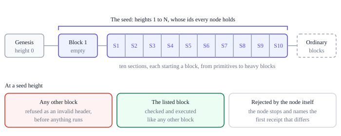

# Conformance and testing

Ting depends on independent implementations agreeing on every byte and every
counter. The [protocol rules](../../../ting-protocol-rules.md) say what to build. Two things
then let any implementation check itself without the reference's code: the chain's
seed, which every node replays, and the consensus vectors, which hold what a valid
chain cannot. Their expectations come from the rules, never from the implementation
that produced them.

## The seed

A chain's first blocks are its seed: the conformance suite, as transactions that
deploy and call programs over every rule the VM and the blocks have, each with the
receipt the rules give it. Every node of the chain replays them, so a node that syncs
the seed has shown that it executes the rules as the chain does.



- **The list.** A node holds the ids of its chain's seed blocks. At a seed height it
  takes the listed block and no other, refused as an invalid header before anything
  is executed, which also stops a competing chain mined from the same genesis.
- **Ordinary validation.** A seed block is checked and executed as any block is;
  there is no test mode.
- **A node that does not conform.** The listed blocks are canonical. When a node's
  own execution rejects one, the fault is the node's, not its peer's: it stops,
  reporting the seed block and the first transaction whose receipt differs from the
  seed's, and holds nothing against the peer.
- **The published seeds.** The production and development seeds are published in
  [`conformance/seed/`](https://github.com/ting-organization/ting/tree/master/conformance/seed)
  in the repository: `production.blocks` and `development.blocks`, each block framed
  with its length, and `production.json` and `development.json`, naming each block's
  section and each transaction's case. The node carries both, and `ting init` and
  `ting init --dev` start a node by importing its chain's seed, every block validated
  and executed, so every node starts with the suite.
- **The production seed.** It was built once, on the production genesis before the
  chain began, and mined at its difficulty: 325 blocks holding 23,540 transactions.
  It holds every case but six, which no production block can hold: deployments of
  modules with branch tables of 131,072 and 131,073 targets, whose code alone grows
  the state by more than a block's 131,072 G; the development seed holds them. It is
  the chain's history, which every change to the VM must keep valid, and it is never
  built again.
- **The development seed.** It is built again from the cases by every test run, and
  written again when a rule changes.

The seed opens with an empty block carrying producer data, then holds its sections in
order, each starting a block:

| Section | What it holds |
|---|---|
| S1 Primitives | Blocks of one to nine transactions, the same transaction twice in a block, a call of an identifier nothing is deployed under; binary input, producer data, events and output, and transactions with no compute or no access left, all valid without any account, signature or nonce |
| S2 Validation | Every acceptance and rejection rule as a deployment: a rejected module fails with status 9, an accepted one runs out at its initializer's first instruction with compute for its installation and entry alone; a module too large for a block, built in memory and deployed from inside; plausible extensions, such as native cryptography, account, time or upgrade imports, rejected even when never used |
| S3 Instructions | Every instruction over its edge operands, with exact dispatch: integer and wide arithmetic, control flow, calls and their traps, globals, select, sign extension |
| S4 Memory and reservations | Every load and store at every edge, the memory prices on both sides of each step and on the curve, growth, data segments, function reservations and stack pages; every price change a deployment and call can afford, with a byte to show it; getters and a deployment's code and input copied whole or not at all across the price steps |
| S5 Host imports | Every import with its span and copy rules, success and each failure, aliased keys and targets included; the context getters against the block; storage reads, writes, lengths and deletes; events, return and revert |
| S6 Deployment and calls | Deployments at every budget boundary and from inside, collisions, a call of a failed deployment, a child's outcomes and retained charges, read-only mode, deep nesting, code prepared once per transaction; reentrancy, siblings and grandchildren rolled back to their own checkpoints, failed initializers that keep their ordinals, the last result replaced by every attempt, and parents that resume at their own memory prices with their operands intact |
| S7 Across blocks | Programs called in later blocks, programs deployed in different blocks calling each other, a program deployed by a program, records written, read, overwritten and deleted across blocks; 4,096 live records created, deleted, recreated, shrunk and regrown, with failed writes between |
| S8 Budgets | Each of C, S, D and G running out at its boundary with earlier debits unchanged, atomic debits refused whole at every memory step and word edge, rollback that keeps its charges, and the remaining budget read through nested calls in every counter |
| S9 Generated programs | Seeded expression trees and seeded programs of statements, each with the outcome and charges a model of it in plain arithmetic states |
| S10 Heavy blocks | Blocks one transaction fills in one resource: compute with small copies across a large memory and with one large growth, accesses with record writes and with nesting as deep as a block allows, data with events, with one input and with outputs a parent discards, and growth over several blocks; and blocks that several transactions fill to exactly each capacity, each with a counterpart one unit over that must be rejected |

The blocks' times are irregular but valid: one is below its parent and a second
above the median of the eleven before it, and others run ahead of and behind
the schedule, so the targets exercise the retarget's fractional steps. Every
block's state root is also checked against a separate tree built from the
cases' declared changes, never from the runtime's.

The seed is the same fixed, heavy workload on every machine and in every
implementation, so it is also the standard measure of how fast a node validates: the
heavy blocks show whether a full block of each kind stays well inside the block
interval.

## Where the seed comes from

The seed is built from the VM tests, `tests/vm/` in the repository, one Rust binary.
Each test states a rule of the [VM pages](../vm.md) as cases: a program in
WebAssembly text with its expected outcome and its charges beside it.

- **Stated expectations.** A case declares what its program does on its path, as a
  ledger of instructions dispatched, bytes copied, records accessed, slots reserved
  and state grown. A model crate with no dependency on the VM turns the ledger into
  the exact C/S/D/G counters the receipt must show, and a module's entry costs are
  read from its shape, never from the decoder. Generated programs carry a model of
  their own, in plain arithmetic.
- **Chain-shaped cases.** Every program is deployed by a transaction, behind a gate
  that lets a program that traps on purpose be installed, and every case checks the
  status, the result, the events, the complete storage and the counters of each step.
- **Built as a chain.** The cases' transactions are packed in order into blocks on
  the chain's genesis and mined, and every block receipt must equal the one the case
  produced on its own, or, for a value only the block decides, the one its
  expectation gives in that block. A fresh validator then replays the result to the
  same blocks and state.
- **No outside engine.** No expectation is taken from another WebAssembly engine,
  and an expected value is never adjusted to what the VM produces: when a case
  fails on its counters, the VM, the model or the reading of the rules is wrong, and
  the rules decide which.

How to write and read a case is described in `tests/vm/README.md`.

## Coverage

A coverage gate replays the seed with the reference interpreter counting what it
runs, and fails with a list of what the seed never exercised:

- every instruction the [protocol rules](../../../ting-protocol-rules.md#19-instruction-reference) list;
- every way each host import can end: by returning, by handing over to a child, or by
  stopping its invocation with each status its rule has;
- every status a top-level or nested call or deployment can end with, status 11 only
  as a child's and status 7 never, since it needs more than 2^64 deployments in one
  transaction;
- every validation rejection reason;
- memory on both sides of each price step and on the curve, and stack pages paid on
  entry and on calls;
- a program called in a later block than the one that deployed it.

The counting is compiled in only for the gate, never into a node.

## Consensus vectors

The consensus vectors are portable inputs and outputs for what a valid chain cannot
hold, one JSON file per vector, in
[`conformance/vectors/`](https://github.com/ting-organization/ting/tree/master/conformance/vectors)
in the repository. Each file names its group, the rule it shows and, as `rules`, the
section of the [protocol rules](../../../ting-protocol-rules.md) that states it, and holds the inputs as hex and the expectation: valid or invalid, or
a computed value. Integers past 2^53 are written as decimal strings. An
implementation need not match error messages.

| Group | What it holds |
|---|---|
| `v1-primitives` | Genesis encodings and ChainIds, domain-separated hashes, ordered commitments with empty and padded lists, record keys, and state roots after writes and deletions |
| `v2-envelopes` | Transactions that decode, and each way one fails: version, kind, truncation, a length past the end, trailing bytes, D below the envelope or past its frame |
| `base` | The development seed's first section, the history the header and block vectors build on |
| `v3-headers` | The next block on the base with one header rule broken: chain, parent, height, target, votes, proof of work, version, and timestamps at and past the median |
| `v4-blocks` | The next block on the base with one body rule broken: framing, the count, producer data, each root, the resources used, receipts that differ from execution, and each resource past the capacity |
| `v5-difficulty` | ASERT targets on schedule, early, late, at fractional half-lives, saturated, and where flooring the exponent differs from truncating it |
| `v6-voting` | Vote directions at the thresholds, steps and floors, saturation, and activation weighed by work |
| `v7-structural` | Modules at the structural bounds and one past each, as recipes of repeated bytes, with an accepted module's code price, preparation and entry slots |
| `v8-work` | Work at boundary targets, and accumulated over a branch |
| `v9-tables` | Memory prices for every page count from 0 to 65,536, hashing, stack pages, and sequences of debits and nested budgets near 2^64 |

A block vector is a block to validate after the first `on` blocks of the base, within
the active data capacity; a rejected block leaves the state as it was. Every invalid
block is a valid one with exactly one rule broken, mined again so that only that rule
fails.

Capacity voting also has a chain of its own, in
[`conformance/chains/`](https://github.com/ting-organization/ting/tree/master/conformance/chains):
`voting.blocks`, 33 valid blocks on a variant of the development genesis with
three-block epochs, whose votes activate increases, holds, decreases and the floor
after the full notice, including two headers out of three voting up with only a
third of the work. `voting.json` gives its genesis and, for every block, its id,
votes, target, the active capacities worked out independently, and its
transaction's id and receipt.

`tests/vectors.rs` and `tests/vm/consensus.rs` work every expectation out from the
protocol rules, without the code under test, and fail when a published file
differs; `tests/conformance.rs` checks the reference implementation against every
file.

The seed and the vectors establish agreement, not capacity: throughput and safe
capacities come from adversarial workload measurements and hashpower and difficulty
simulations, as for the [production profile](../consensus/genesis.md#production-profile).

## Reference tests

What only the reference implementation has is tested in Rust beside it: block
assembly and its cancellation at capacity, the state tree against its definition and
its proofs, a storage failure that never becomes a receipt, the wire formats, and on
the node side reorganizations, restarts, crash recovery, corrupted files, two-node
synchronization, the API, and a node that takes the development seed from a peer,
checked against its list, restarts on its store and carries on. The seed and the
voting chain are also imported through the node with a 1 MiB database cache,
reopening the store every 17 blocks and importing the same block again after each
restart, before an ordinary block is mined on top.

## Running them

```sh
cargo test --workspace --locked
cargo test --release --package ting-core --features coverage --test vm coverage
cargo test --release --package ting-node --test seed_replay -- --ignored
```

After a deliberate change to the rules, the published seed, chains and vectors are written
again from the protocol rules instead of compared, and the difference is reviewed:

```sh
TING_WRITE_VECTORS=1 cargo test --test vectors
TING_WRITE_VECTORS=1 cargo test --test vm -- consensus seed:: chain_histories
```

## How the reference changes

- **Rules first.** A change to instruction behavior, charging, the host interface or
  failure order is written into the protocol rules before any code: its bytes,
  semantics, meter events and boundary cases.
- **Own code, independent evidence.** The VM is implemented here, and every change
  to it must keep the VM tests passing. Expected values are never regenerated from
  the implementation under test.
- **The seed follows.** A change to the rules changes the cases, and with them the
  development seed and the vectors, which are written again and reviewed.
- **Nothing implicit.** Dependency defaults never define the accepted profile. Unknown
  instructions, imports and features are rejected.
- **Exact tests.** Every change comes with cases that state its outcome and its exact
  accounting.
- **No physical accounting.** CPU timing, interpreter fuel and cache state never define a counter.
