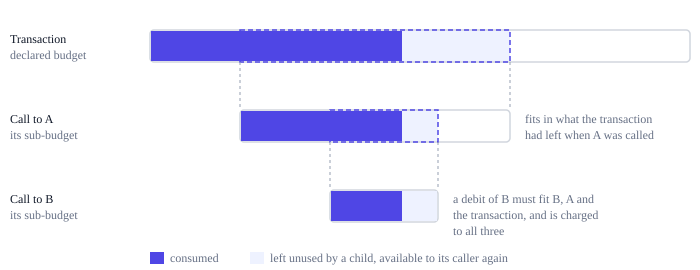

# Budgets and exhaustion

A transaction says in advance how much of each resource it may use, and a program
that calls another program passes on part of what it has left. Every counted event
is a debit against those budgets: it either fits all of them and happens, or it does
not happen at all. This page explains how budgets nest, what happens when a debit
does not fit, and why nothing consumed is ever given back. The exact rules are in
[section 11 of the protocol rules](../../../ting-protocol-rules.md#11-budgets-and-exhaustion).

## Budgets within budgets

A transaction declares its maximum C, S, D and G. When a program calls another
contract, it gives the child a sub-budget that must fit in what the caller has left.
Whatever the child consumes is also charged to every enclosing budget, and whatever it
doesn't use stays available to the caller.



Each invocation with its own budget is a **frame**: the transaction's top-level
invocation, whose budget is the declared one, and every nested call or deployment,
whose budget is its sub-budget. Every frame has a budget and a consumed vector that
only ever grows. A request for a sub-budget larger than the caller has left creates
no child; see [Calls, rollback and read-only](../vm/calls.md).

For example, a program may call an untrusted contract with a sub-budget of 500,000 C.
If the child uses 200,000 C and then runs out of S, its changes are undone, the
200,000 C stay charged to the caller and to the transaction, and the 300,000 C it
never used were never taken from the caller. However the child behaves, it can
consume no more than the sub-budget it was given.

## Atomic debits

Before each counted event, the whole debit is checked against the current frame and
every frame around it. If it fits everywhere, it is charged everywhere and the event
happens. If not, nothing is charged, the event does not happen, and the invocation
that attempted it fails.

```text
debit v = [c, s, d, g] attempted by frame f:
    if consumed(x) + v <= budget(x) for f and every frame enclosing f:
        consumed(x) += v for all of those frames
        perform the event
    else:
        apply no part of v, do not perform the event, and fail f
```

Because a debit is all or nothing, a write that cannot pay for its growth writes
nothing, and an instruction that cannot pay its price does not run. Earlier debits
that succeeded stay consumed. When an event would exceed more than one allowance at
once, the failure reports the first in the order C, S, D, G, so every implementation
reports the same status:

| First counter that does not fit | Status of the failed invocation |
|---|---:|
| C | 3 |
| S | 4 |
| D | 5 |
| G | 6 |

The failed invocation's effects are rolled back and its caller receives the status
and may continue; at top level it becomes the status in the
[receipt](../data/blocks.md). Which checks a host function makes before its debit,
and in what order, is in
[the host interface](../../../ting-protocol-rules.md#22-the-host-interface).

## Nothing is refunded

Rollback restores state, never counters. A child that fails keeps its consumption
charged to its parent. A transaction that fails keeps everything it consumed, in its
receipt and in the block total: the receipt records actual consumption, including
all work done before a failure. Unused allowance is simply not consumed; there is
nothing to refund because it was never spent. Every validator did the work a failed
call did, so its cost stays. If rollback restored counters, a transaction could do
work, revert it and do it again, far more than its budget shows.
[Nothing is refunded](../decisions/no-refunds.md) explains the decision.

A consumed vector can neither overflow nor become negative: it only grows, and only
by debits that fit under a budget.

## Exhaustion is per transaction

A transaction runs out when its own budget is exhausted, never because the block is
filling up. Whether a block's transactions fit the block's capacity is a separate
check. A block that does not fit is invalid; its transactions do not get different
outcomes to make it fit. See [Block capacity and bounds](capacity.md).
