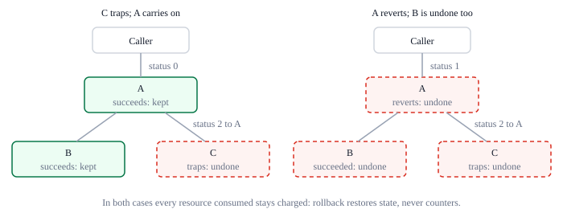

# Calls, rollback and read-only

A program can call another contract or deploy new code. Either runs as a nested
invocation with its own sub-budget, and a failed child does not fail the program
that started it: the caller gets the child's status and decides what to do. This is
what lets programs compose safely, since a caller can try something, see it fail and
carry on with the child's changes undone. This page covers what a child sees, what a
failure undoes, read-only mode, depth and reentrancy. The exact rules are in
[section 24 of the protocol rules](../../../ting-protocol-rules.md#24-calls-rollback-and-read-only).

## Calling another contract

`call` takes a target, input bytes, a sub-budget and a read-only flag. The child runs
a fresh instance of the target's code, sees every earlier successful write in the
transaction, and returns a status. Its result bytes wait in the caller's
**last-result buffer** until read with `call_result`; the next call or deployment
replaces them. A call to a contract that does not exist returns status 8.

The sub-budget may be no greater, in any counter, than what the caller has left once
the call has copied the target and the budget. If it is greater, `call` returns 128
and no child is created; the caller can treat that like any other failed call and
continue. What the child consumes counts against its own budget and every enclosing
one; what it leaves unused is available to the caller again
([budgets within budgets](../resources/budgets.md#budgets-within-budgets)).

A program that wants to pass on everything it has can read its remaining budget
from the context and subtract what it will spend itself: the call's copy of the
target and the budget, and its own work afterwards. The child pays for receiving
its input out of its own budget, so the size of the input never eats into what the
caller kept back. The stages a call goes through, and what each costs, are on
[the host interface](host.md#calls-and-deployments).

## Deploying from a program

`deploy` works like `call`, but installs new code first and runs it as its
initializer ([deployment](lifecycle.md#deployment)). Installation is
transactional: a failed initializer rolls back the code, the manifest and every
effect of its descendants. When it succeeds, the new ContractId is available
through `call_result`.

## Checkpoints

Every invocation begins with a checkpoint of state and events.

- When it succeeds, its changes and events stay.
- When it fails, whether by revert, trap or exhaustion, everything since its
  checkpoint is undone, including the effects of children that had succeeded.
- The caller receives the failure status and the child's result bytes, and decides
  what to do. A failed child does not fail its caller. If the caller later fails
  itself, everything since its own checkpoint is undone, its children's retained
  effects included.

At the top level, a failed transaction restores the state from before the
transaction and drops all its events. Its receipt still records the failure
status, the top-level result bytes where there are any, such as a revert's, and
the resources consumed ([receipts](../data/blocks.md#receipts)). Consumed
resources stay charged at every level: rollback restores state, never counters.

## Read-only mode

A read-only invocation can compute and read storage, but cannot set or delete records,
deploy code or emit events. Attempting any of these fails the invocation with
status 11 before any span is checked and before anything changes. Read-only mode
passes to every nested call, and a callee cannot switch it off: an inherited
restriction overrides a call made with flags 0. A caller can use it to query
another contract with the guarantee that the call changes nothing.

## Depth

There is no fixed nesting limit. Every nested invocation reads two records and pays
for its own instance, so budgets bound how deep a transaction can go. Implementations
must run nested invocations without depending on the host processor's stack; the
reference runtime drives them with an explicit loop rather than recursion
([host calls](execution.md#host-calls)).

## Reentrancy

A contract can be called again while an earlier invocation of it is still active.
Each invocation gets a fresh instance but sees the same transactional state.
Guarding against reentrancy, like authorization, is the program's job. No caller
identity is ever inferred from input: a program learns its immediate caller only
from the context.

## Failures that are not outcomes

Only the outcomes an invocation can end with
([how an invocation ends](execution.md#how-an-invocation-ends)) can appear in a
receipt. Malformed transaction framing is not one: it makes the block invalid
([transactions](../data/blocks.md#transactions)). Invalid deployable code is an
ordinary deployment failure, status 9, after its charges. Installed code that is not
valid would violate the state invariant and is never an alternative VM result
([installed code](lifecycle.md#installed-code-is-always-valid)).
