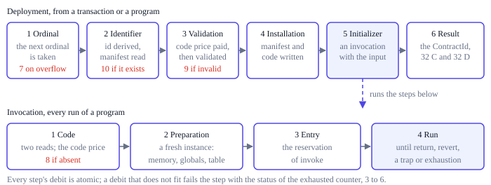

# Deploy and invoke

A deployment installs immutable code and runs it once as its initializer; an
invocation runs installed code. Both happen the same way whether a transaction or
another program asks for them, and both go through a fixed sequence of steps, each
with its own charge, so that a node that runs out of budget does so at the same step,
with the same counters, as every other. Every charge is atomic: if it does not fit,
nothing of it is charged and the step fails with the status of the exhausted counter
([atomic debits](../resources/budgets.md#atomic-debits)). The exact rules are in
[section 23 of the protocol rules](../../../ting-protocol-rules.md#23-deploy-and-invoke).

## Deployment

A top-level deployment starts at step 1. A deployment from a program gets there
once it has passed the `deploy` import's own checks and received its code and input
([calls and deployments](host.md#calls-and-deployments)).

1. **Ordinal.** The transaction's deployment counter, which starts at zero, gives
   the deployment its ordinal and moves on. Rollback never restores it, so a failed
   deployment still uses its ordinal.
2. **Identifier.** The ContractId is derived from the chain, the transaction and the
   ordinal ([identifiers](../data/records.md#identifiers)) for 1,900 C, and its
   manifest record is read for another 1,900 C and one S. If a contract already
   exists there, the deployment fails with status 10.
3. **Validation.** The deployment pays the code's
   [code price](../resources/prices.md#code) and the price of hashing it into its
   CodeHash, then the module is [validated](profile.md#validation). Invalid code
   fails with status 9, and the charge stays. Valid code counts as prepared for the
   rest of the transaction, so its initializer and later runs of the same code in the
   same transaction do not pay the code price again.
4. **Installation.** The manifest and the code record are written. Each write is
   priced like a program's [storage write](host.md#storage-writes): 1,900 C and one
   S for the key and the read of the old record, then the price of hashing the value,
   a second S and the record's [growth](../resources/growth.md).
5. **Initializer.** The new contract is invoked as under [Invocation](#invocation),
   with the deployment's input, in ordinary mode, with the deploying contract as its
   caller, or none at the top level. It can write the new contract's storage, call
   other contracts and emit events.
6. **Identifier result.** When the initializer succeeds, 32 C and 32 D pay for the
   deployment's result, the new 32-byte ContractId. The initializer's own result
   bytes are discarded, though they were charged when it returned them. A top-level
   deployment's receipt carries the ContractId; a program reads it with
   `call_result`.

If any step fails, the installation and everything the initializer and its
descendants did are rolled back; the ordinal stays used and everything consumed
stays charged. A failed initializer's status and result bytes become the
deployment's outcome, so a revert's bytes reach the deployer. A failure before the
initializer has an empty result.

## Invocation

Before its top-level call or deployment, a transaction pays its data base
([D, data](../resources/counters.md#d-data)) and 1 C of root dispatch. Then every
run of a program, top-level, nested or an initializer, takes the same four steps:

1. **Code.** The contract's manifest and its code record are read, for 1,900 C and
   one S each; a call to a contract that does not exist ends here with status 8.
   Unless the transaction has already prepared code with this CodeHash, the
   [code price](../resources/prices.md#code) recorded in the manifest is paid for
   loading it, even when the node holds a compiled copy. No byte of the code is
   read before it is paid for.
2. **Preparation.** One charge pays for starting the instance, 40,000 C, for its
   initial memory, 40,000 C a page, and for setting its globals and table and copying
   its data segments ([invocations](../resources/prices.md#invocations)). Then the
   fresh instance is built ([instances](execution.md#instances)).
3. **Entry.** The reservation of `invoke` is paid
   ([function entry](metering.md#function-entry)).
4. **Run.** `invoke` executes. The program reads its input and context through host
   functions and ends with `return`, with `revert`, with a trap, by exhausting a
   budget, or by simply finishing, which is a successful empty return.

Nothing survives an invocation except storage records, retained events and the
result. Globals, the table and memory are rebuilt from the immutable code every
time, so two calls to the same contract within one transaction each start from
scratch, and the only lasting program state is what the storage functions write.

## Installed code is always valid

Code was validated when it was deployed, and its manifest and code record always
agree, so an invocation never meets invalid code. A node that finds otherwise holds
corrupt state: that is a fault of the node, never an outcome of the VM.

A node may compile and cache modules however it likes, but a cache hit must give
exactly the outcome and counters of a cold start. That is why code is read and paid
for even when the node already holds it compiled: whether code is prepared is part
of the transaction's own history, not of any node's cache.
